# Lingua — AI English Tutor

An AI-powered English tutor built with **Flutter**, **FastAPI**, **OpenAI** and **Supabase (PostgreSQL)**.
Learners practise through short, structured conversations, with text or voice input. The AI tutor
grades one task at a time. The backend validates every AI reply, and progress is saved atomically
in the database.

> Portfolio project. The goal is a small but complete LLM application: structured outputs,
> server-side validation, state management, authentication and tests. It does not train a model.

<p align="center">
  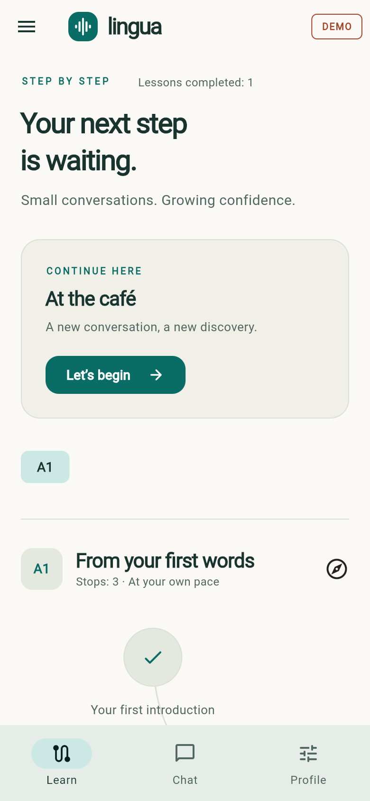
  &nbsp;
  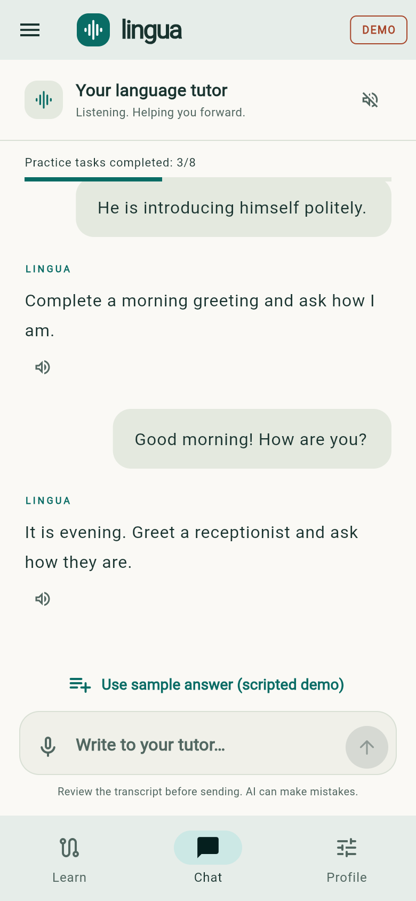
  &nbsp;
  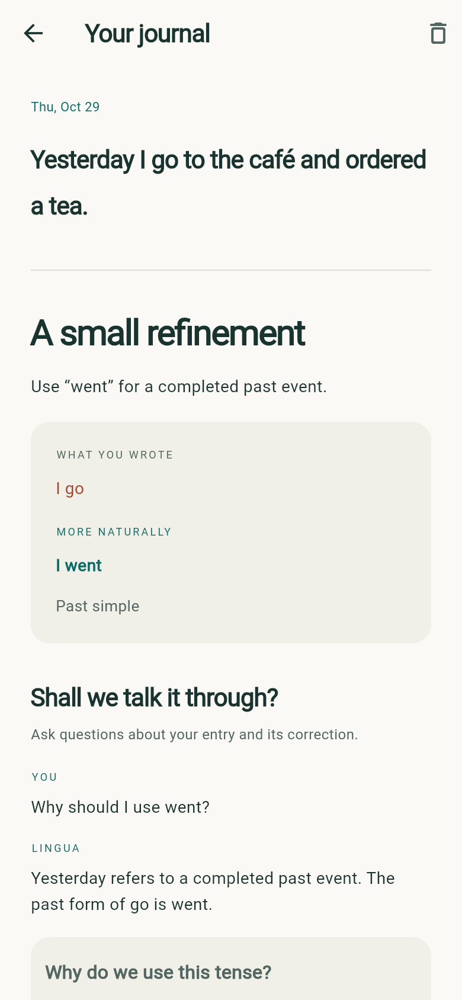
</p>

## Highlights

- **103 English lessons (A1–C1)**, each split into 8 tracked practice tasks: 2 comprehension,
  2 guided, 3 independent and 1 transfer task in a new situation.
- **Structured AI output.** `gpt-4o-mini` must answer in a strict JSON schema (feedback text,
  mistakes, reviews, `task_passed`, …). Replies are capped at **200 tokens**.
- **The server decides progress, not the model.** The AI's verdict is validated in Python. Then a
  single PostgreSQL function saves the messages, mistakes and progress in one transaction.
- **Mistake memory with spaced repetition.** Corrected errors come back for review after 1, 3 and
  7 days. A mistake counts as mastered after three successful reviews.
- **Voice:** speech-to-text with `whisper-1` (the server checks the WAV first). Tutor replies can
  be read aloud with `tts-1`.
- **Placement test** of 10 server-selected questions. It gives a provisional starting level.
- **Private journal** with one focused correction and a follow-up discussion.
- **Read-only conversation history.** Opening an old conversation never calls the AI.
- **6 interface / explanation languages:** English, Hungarian, Romanian, German, French and
  Spanish. English is the only language being taught.
- Light and dark themes, plus a responsive layout for desktop and phone.

## Screenshots

| Sign in | Lessons on the path | Lesson completed (8/8) |
| :---: | :---: | :---: |
| 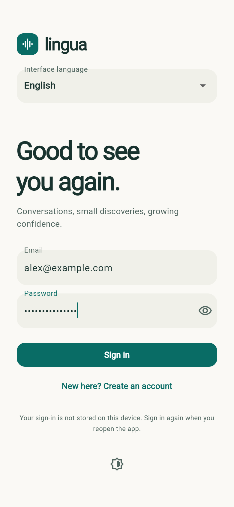 | 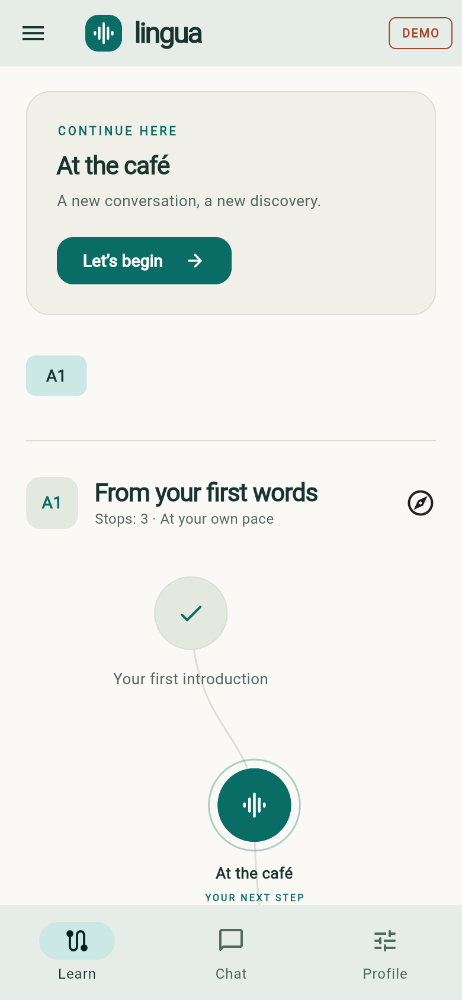 | 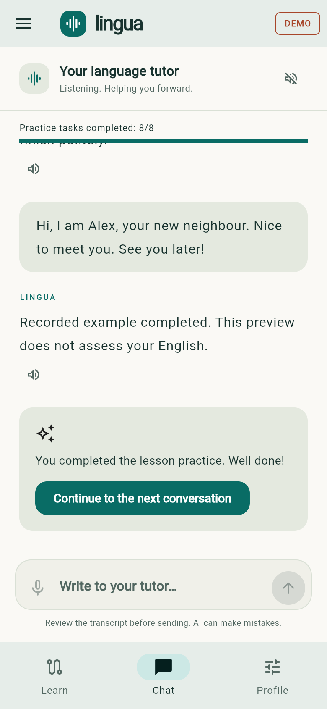 |
| **Navigation menu** | **Journal** | **Interface languages** |
| 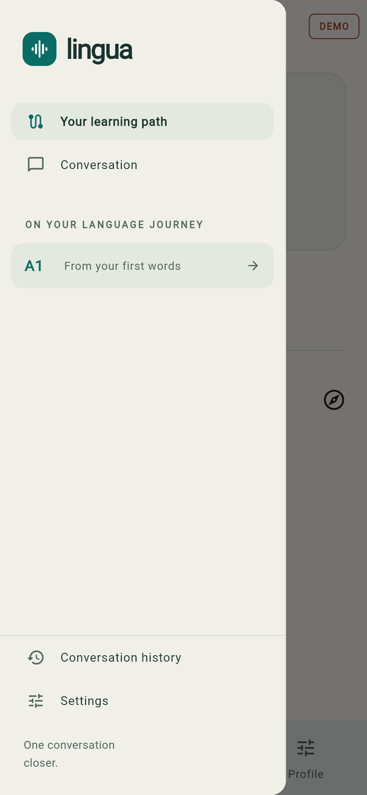 | 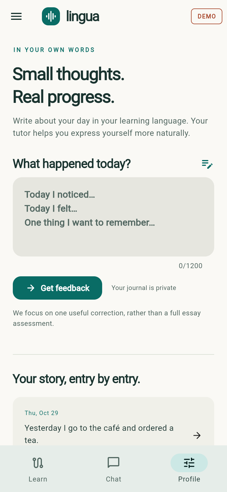 | 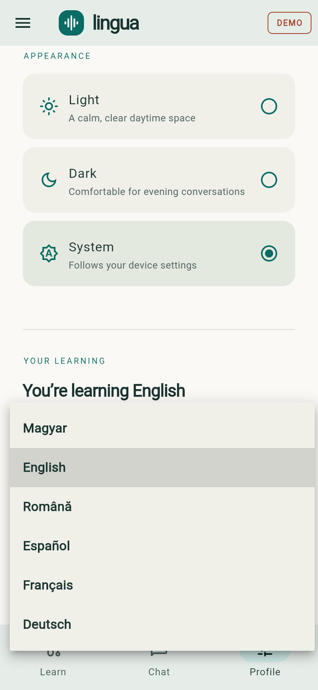 |
| **Dark theme: conversation** | **Dark theme: learning path** | **Hungarian interface** |
| 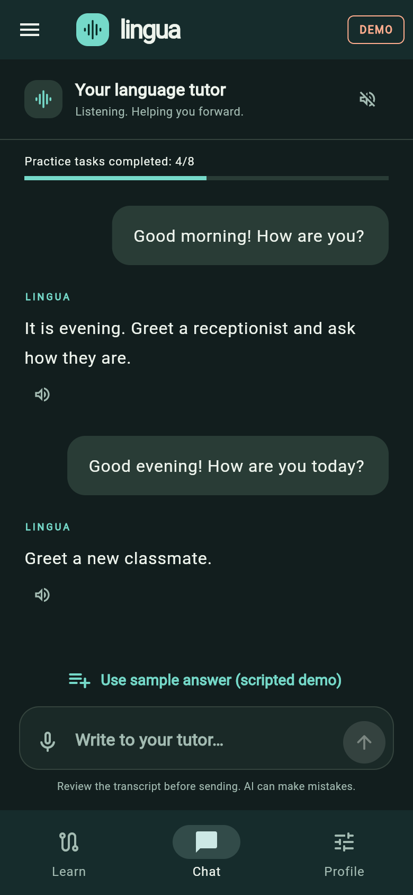 | 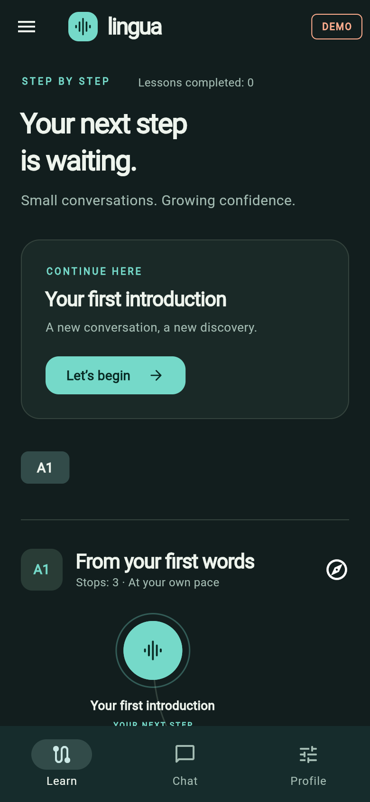 | 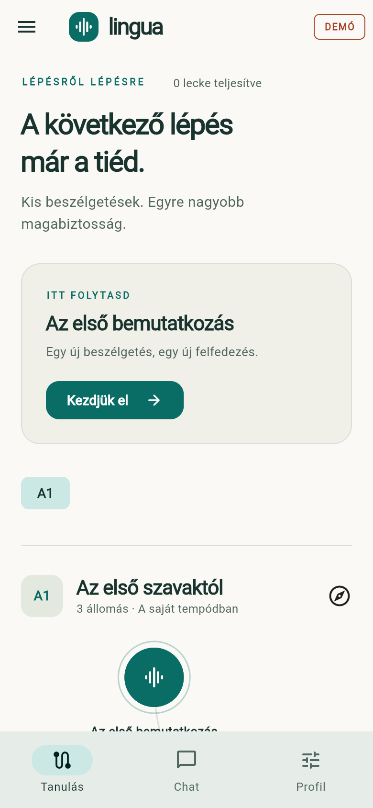 |

<sub>Phone-size screenshots of the Flutter web build. Except for the sign-in screen, they come
from the built-in demo mode (see below), which is why the “DEMO” badge is visible.</sub>

## Try the UI in 1 minute (no API keys)

The Flutter app has a **demo mode** that shows the interface with three pre-written lessons.
The tutor replies in the demo are scripted, not generated by an AI, so it does not need a
backend, OpenAI or Supabase. The real AI tutor needs the full setup below with your own API keys.

```powershell
cd flutter_app
flutter pub get
flutter run -d chrome --dart-define=DEMO_MODE=true
```

Click **“Use sample answer”** and then send it to step through a lesson. The demo does not grade
free text and does not call an AI.

## Architecture

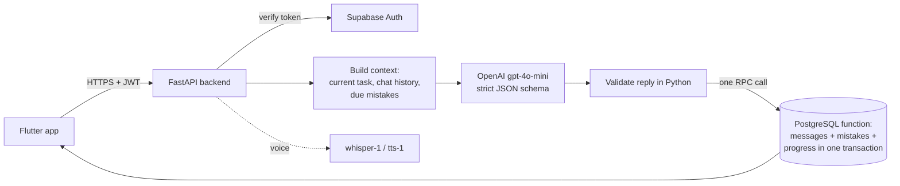

The Flutter app only talks to the FastAPI backend. It never holds a database or OpenAI key.

### What happens when a learner sends a message

1. The app sends the message with a fresh `request_id` (UUID). If the request fails, the app
   retries with the same ID, so the answer is never saved twice.
2. FastAPI checks the input with Pydantic, checks that the token belongs to this profile, and
   applies a per-user rate limit.
3. `TutorService` loads the current lesson, the saved conversation, the current task index and the
   mistakes that are due for review.
4. The model gets the system prompt for **only the current task**. It must answer in a strict
   JSON schema (OpenAI Structured Outputs).
5. Python validates the reply. For example: a reported mistake must really appear in the learner's
   text, a review must refer to a mistake ID that was offered, and a lesson can only be completed
   after task 8 passes.
6. The PostgreSQL function `tutor_commit_turn` saves everything in one transaction. It locks the
   profile and checks the session `revision`, so two concurrent requests cannot both advance the
   lesson.

## Key engineering decisions

| Problem | Solution |
| --- | --- |
| LLMs return free text that is hard to parse | Strict JSON schema plus Pydantic validation. Malformed replies are rejected (HTTP 502) and nothing is saved. |
| The model may “pass” a learner too early | Progress is replayed from saved task results. The SQL function rejects completion before all 8 tasks have passed. |
| Network retries could create duplicate data | Client-generated `request_id`. A retry returns the saved result. |
| Two tabs sending at the same time | Row lock on the profile plus an optimistic `revision` check on the session. |
| Prompt injection and off-topic requests | Learner text is treated as untrusted data. The model cannot change scores or levels, because the server validates them. |
| Cost control | 200 output tokens per reply, a bounded chat history, per-user and per-IP rate limits, and a 16-second limit on recordings. |
| Secrets | The service-role key and the OpenAI key stay on the server. RLS is enabled on every table, and browser roles cannot call the database functions. |

## Tech stack

| Layer | Technologies |
| --- | --- |
| Client | Flutter 3.19 (web, Android, iOS), `http`, `record`, `audioplayers`, `shared_preferences` |
| Backend | Python 3.12, FastAPI, Pydantic v2, OpenAI SDK, supabase-py |
| Database | Supabase PostgreSQL, PL/pgSQL functions, Row Level Security, Supabase Auth |
| AI | `gpt-4o-mini` (Structured Outputs), `whisper-1` (speech-to-text), `tts-1` (text-to-speech) |
| Quality | pytest, Node test runner + PGlite (real PostgreSQL in tests), Flutter widget tests, GitHub Actions |
| Ops | Dockerfile for the backend, health and readiness endpoints |

## Run the full app

Requirements: Python 3.12, Flutter 3.19+, a Supabase project and an OpenAI API key.

1. **Database.** In the Supabase SQL Editor, run `database/schema.sql` and then
   `database/functions.sql`.
2. **Environment.** Copy `.env.example` to `.env` and fill in the values. The comments in the file
   explain each key.
3. **Backend and lessons:**

   ```powershell
   py -3.12 -m venv .venv
   .\.venv\Scripts\python.exe -m pip install -r requirements-server.txt
   .\.venv\Scripts\python.exe -m tools.seed_database --check            # validate lessons locally
   .\.venv\Scripts\python.exe -m tools.seed_database --refresh-prompts  # upload the 103 lessons
   .\.venv\Scripts\python.exe -m backend.api                            # http://127.0.0.1:8000/docs
   ```

4. **Flutter app** (in a second terminal):

   ```powershell
   cd flutter_app
   flutter run -d chrome --dart-define=API_BASE_URL=http://127.0.0.1:8000
   ```

To check the backend, open http://127.0.0.1:8000/health/ready. It should return
`{"status":"ready"}` once both SQL files are installed.

**Android phone over USB** (the backend keeps running on your computer):

```powershell
adb reverse tcp:8000 tcp:8000
cd flutter_app
flutter run -d <device-id> --dart-define=API_BASE_URL=http://127.0.0.1:8000
```

**Docker (optional, backend only):**

```powershell
docker build -t lingua-backend .
docker run --rm -p 127.0.0.1:8000:8000 --env-file .env -e APP_ENV=development lingua-backend
```

## Tests

```powershell
.\.venv\Scripts\python.exe -m pip install -r requirements-dev.txt
.\.venv\Scripts\python.exe -m pytest -q          # backend: 137 tests
.\.venv\Scripts\python.exe -m tools.course_audit  # validates all 103 lesson plans

cd tests/sql; npm ci; npm test                    # SQL functions on real PostgreSQL (PGlite): 25 tests

cd flutter_app; flutter analyze; flutter test     # Flutter: 61 tests
```

GitHub Actions runs the same checks on every push ([workflow](.github/workflows/checks.yml)).
The backend tests mock OpenAI and Supabase, so they need no keys and cost nothing.

## Project structure

```
backend/        FastAPI app, tutor engine, journal, auth, audio validation, rate limiting
flutter_app/    Flutter client, demo mode, translations (lib/l10n), widget tests
curriculum/     103 lesson plans as JSON (A1–C1) and a manifest
database/       schema.sql (tables, RLS) and functions.sql (transactional business logic)
tools/          lesson import/seed, curriculum audit, optional live AI evaluations
tests/          pytest suites and SQL transaction tests (tests/sql)
docs/           verification report and screenshots
```

## Limitations

- The lessons are an **editorial pilot**. They use the British Council / EAQUALS Core Inventory
  for General English as a reference for the levels. They are technically validated, but no
  language teacher has reviewed them, and the placement test is not a CEFR certificate.
- Transcription shows *what* was said, not *how* it was pronounced. Pronunciation is not assessed.
- Prompt rules reduce prompt injection but cannot fully prevent it. That is why scores, levels
  and progress are validated on the server.
- The rate limiter keeps its state in memory, so it works for a single server process. Several
  instances would need a shared store, such as Redis.

## More

- [docs/VERIFICATION.md](docs/VERIFICATION.md): local test results and live AI evaluation runs
